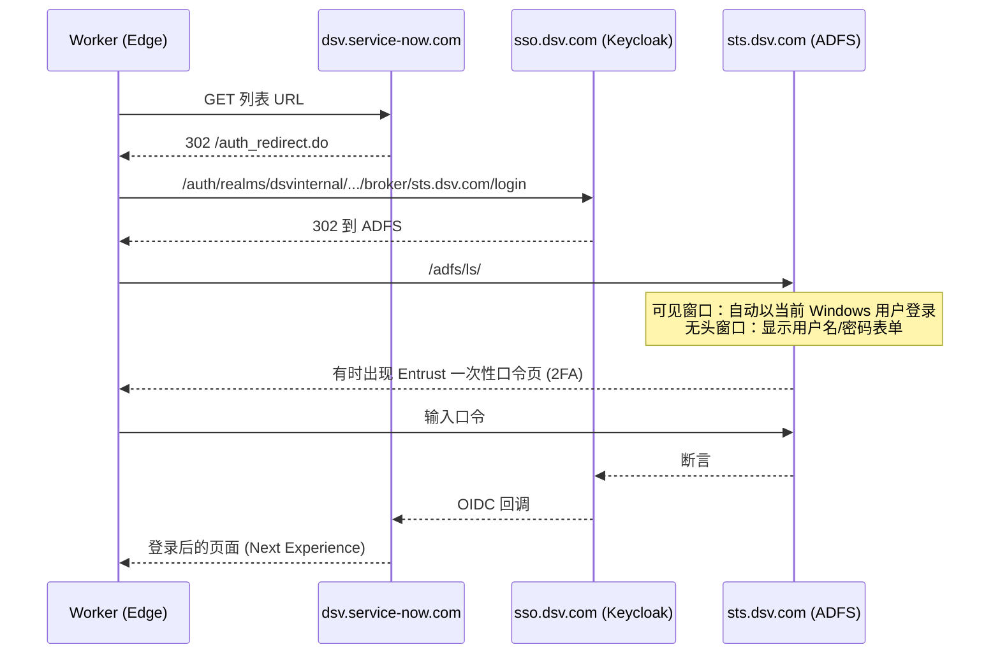
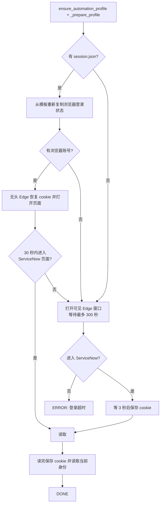

# ServiceNow 数据表：鉴权与登录

本文说明 `servicenow_worker.py` 如何登录 DSV ServiceNow、会话与浏览器状态如何保存、登录身份如何实现，以及出问题时怎么排查。
实验过程和原始结果见 [experiments.md](experiments.md)，功能概览见 [README.md](README.md)。

## 1. 基本模型

- 读取由**运行服务的那台电脑**上的 Playwright + Edge 完成，使用这台电脑上保存的登录会话。
- 访问者的浏览器只是界面，不参与登录，也不提供任何 cookie。
- 数据是以**该电脑上登录的账号**的权限读到的。
- 需要登录或 2FA 时，Edge 窗口弹在服务器那台电脑的屏幕上，只有坐在那台电脑前的人能完成。

## 2. 登录链路



- ServiceNow 本身不保存密码，身份来自 Keycloak，Keycloak 再委托给公司 ADFS。
- ADFS 表单的输入框：用户名 `UserName`（id `userNameInput`）、密码 `Password`（id `passwordInput`）、`Kmsi` 复选框；2FA 页的口令输入框 `Passcode`（id `challengeResponse`），页面标题含 `Entrust Identity Essentials Multi-Factor Authentication`。

## 3. 为什么不用日常 Edge profile

| 方案 | 结果 |
|---|---|
| 复制正在运行的 Edge profile | 失败。Edge 运行时对 `Network/Cookies` 独占加锁，任何用户态方式都拷不出来。 |
| 用 Playwright 直接打开日常 profile | 失败。Edge 已在运行时会把请求转交给现有进程；且 Edge 136+ 不再响应对**默认数据目录**的调试端口/管道。 |
| 连接日常 Edge 的调试端口 | 同上，默认数据目录下不可用。 |
| **专用自动化 profile（采用）** | 可行。 |

## 4. 登录身份与磁盘布局

每个软件用户可以有多个登录身份（存在用户设置 `servicenow_accounts`，含最近一次读到的用户名）。每个身份在磁盘上有自己的目录：

```
%LOCALAPPDATA%\VideoTranscript\servicenow\<软件用户id>\<身份id>\
    edge\          该身份的 Edge 数据目录（VT_EDGE_AUTOMATION_DIR）
    session.json  该身份的 cookie 备份（VT_SN_SESSION_FILE）
```

- `<身份id>` 只允许 `[a-z0-9]{1,16}`，`<软件用户id>` 只允许 `[A-Za-z0-9_-]{1,36}`，因为都会成为路径片段；后端还要求身份必须在该软件用户自己的身份列表里，所以不能通过猜 id 使用别人的登录状态。
- 旧版本的单个 cookie 文件 `%LOCALAPPDATA%\VideoTranscript\servicenow-session.json` 在第一次访问时被移动到“默认”身份下，且只移动给**最早创建的软件用户**，避免被后来注册的用户拿走。
- Teams 等其它工具不受影响，它们仍使用 `browser_utils.get_automation_user_data_dir()` 决定的目录（`%LOCALAPPDATA%\VideoTranscript\edge-automation\<Edge profile 名>\`）。这个目录同时也是新身份的“模板”，见第 7 节。
- 后端同一时间只允许一个 ServiceNow 任务；登录、读取、删除身份、清除登录互斥。

### 登录身份的限制

目前**每个身份最终都以运行服务那台电脑的 Windows 用户登录**。原因是可见的 Edge 窗口里 ADFS 会自动完成 Windows 登录，没有输入其它账号的机会，试过的禁用办法都无效（见 [experiments.md](experiments.md) 实验 4、5）。所以现在多个身份只是“独立保存的会话”，用于各自保存/清除登录状态，不能直接登录成别人。

## 5. Worker 里的登录状态机



对应代码（`servicenow_worker.py`）：

- `_ensure_login`：上面的流程。`HEADLESS_SSO_SECS = 30`，`LOGIN_WAIT_SECS = 300`（给 2FA 留时间）。可见窗口登录成功后 worker 自己关闭窗口并继续，不需要手动关。
- `_on_servicenow(url)`：判断“已登录”。主机以 `service-now.com` 结尾，且 URL 不含 `/login.do`、`/sso/`、`/auth_redirect.do`。`/auth_redirect.do` 是跳往 SSO 前的中转地址，不排除会被误判为成功。
- 之后每个 URL 在 `_count_one` 里会再次导航并再等最多 60 秒进入 ServiceNow。

## 6. 会话 cookie 不会被 Edge 保存

Keycloak、ADFS、ServiceNow 的会话 cookie 没有过期时间（session cookie），Edge 关闭时直接丢弃，自动化 profile 里保存不下来，所以每次都要重新登录。

做法：

- `_save_session(ctx)`：把 `dsv.com`、`service-now.com`、`microsoftonline.com` 域下的 cookie 写入该身份的 `session.json`。
- `_restore_session(ctx)`：启动后、导航前，用 `ctx.add_cookies` 恢复未过期的 cookie（`expires == -1` 的会话 cookie 视为有效）。
- 保存时机：可见窗口登录成功并等待 3 秒后；读取/登录完成后。
- 恢复后若服务端会话已失效，会自然落回登录流程。

**安全**：这个文件里是仍然有效的登录凭据，明文保存。不要提交到仓库，不要分享，不要放到云同步目录。清除登录状态时删除它（页面上的“清除登录”会删除整个身份目录）。

## 7. 浏览器级登录状态（force sign-in 问题）

**现象**：新建的 Edge 数据目录，第一次启动正常，之后每次启动都报
`BrowserType.launch_persistent_context: Protocol error (Browser.getWindowForTarget): Browser window not found`。

**根因**：公司策略强制 Edge 登录（force sign-in）。一个没有浏览器账号的 profile 启动时会打开 `edge://force-signin/` 页面，这个页面没有普通浏览器窗口，Playwright 启动持久化上下文时对它查询窗口就失败。另外：
- 新 profile 第一次可见启动会自动登录 Windows 账号，`Preferences` 里出现 `account_info`；
- 之后的**无头启动会让这个账号被清除**（`account_info` 变回空），下一次启动就出现 force-signin 页面；
- 日志里的 `portal.office.com ... failed to install` 只是噪音，不是原因。

**做法**（`_prepare_profile`）：从 Teams 等工具共用的自动化 profile（`get_automation_user_data_dir()`，忽略当前身份的目录覆盖）复制浏览器登录状态到新身份目录，只复制这些文件：`Default\Preferences`、`Default\Secure Preferences`、`Default\Web Data`（含 journal）、根目录 `Local State`、`OneAuth\` 目录。**不复制** cookie、Local Storage、IndexedDB 等站点数据，所以不会把别的会话带过来。

- 新身份第一次启动前复制一次。
- 每次要走无头之前**强制重新复制**。实验显示：可见登录之后账号仍在，但紧接着的无头启动会失败并清掉账号；重新复制后无头启动恢复正常，且连续多次可用（实验 7）。
- 没有模板（例如这台电脑还没用过 Teams 工具、共用 profile 里没有账号）时，不走无头，直接弹可见窗口登录。结果是每次读取都会短暂弹出窗口，但仍然可用。

## 8. 关于浏览器标识（User-Agent）

`_launch` 会把 `HeadlessChrome` 改成 `Chrome`，去掉 `--enable-automation`，并加 `--disable-blink-features=AutomationControlled`。

**需要更正之前的说法**：曾经认为“HeadlessChrome 标识会让 ADFS 跳过 Windows 静默登录，改标识后就能静默登录”，**这个解释没有得到证实**：

- 全新 profile + 无头：不管改不改标识，都会出现密码表单（实验 3）。
- 全新 profile + 可见窗口：不改标识也会自动登录（实验 4、5）。
- 只有在一个已有登录痕迹的目录里，默认标识显示密码表单、改标识后到达口令页（实验 2），原因没有查清。

所以现在保留这些设置是因为它们无害且曾经对已有登录痕迹的目录有效，真正让重复登录消失的是第 6 节的 cookie 备份与恢复。

## 9. 读取数据时的鉴权与身份

登录后 worker 在页面内发起请求，使用页面自己的会话：

1. 优先读页面当前的 `window.g_ck`；读不到时用 `page.on("request")` 抓到的请求头 `X-UserToken`（最多等 30 秒）。**不能只信抓到的 token**：登录跳转期间匿名页面发出的请求也带 `X-UserToken`，它在登录后已失效，拿去请求会 401（见实验 10）。
2. 在页面里执行 `fetch('/api/now/stats/<表>?sysparm_count=true&sysparm_query=<查询>', {credentials: 'same-origin', headers: {'X-UserToken': token}})`。
3. 返回 200 时取 `result.stats.count`；非 200（如 401/403）或异常时，退回读页面上标题后面的数字徽章。
4. 当前身份：`fetch('/api/now/ui/user/current_user')`，取 `user_name` 和 `user_display_name`，通过 `IDENTITY:` 行告诉后端并保存到身份列表。`_identity` 每次重新取 token，遇到非 200 或异常就每秒重试（登录命令最多 30 次，读取数据时 5 次），因为刚登录完页面还在加载，token 可能还没就绪。
5. 前端 `login()` 结束后（无论 `done` 还是 `error`）都会重新请求 `/api/servicenow/accounts`。后端的 `logged_in` 只看 `session.json` 是否存在，而前端原来只在收到 `identity` 事件时才标记已登录，两者可能不同步。

权限与在界面上看到列表的权限一致，没有额外的 API 账号。

## 10. 排查表

| 现象 | 可能原因 | 处理 |
|---|---|---|
| 每次运行都弹出登录窗口 | `session.json` 不存在或被清除；服务端会话已过期；没有模板导致不走无头（第 7 节） | 登录一次后检查该身份目录下是否生成 `session.json`；确认共用的自动化 profile 里有浏览器账号 |
| `Browser window not found` | 该身份的 Edge 目录没有浏览器账号，出现 force-signin 页面 | 确认共用自动化 profile 可用；删除该身份的 `edge\` 目录后重试，或在页面上“清除登录”后重新登录 |
| 页面显示 “For security reasons…/Access denied” | 在 ADFS 页面停留过久、口令输入错误或超时 | 关闭窗口后重试，重新输入口令 |
| 弹出的是 Edge profile 选择窗口 | 缺少 `--profile-directory=Default`，或 Local State 带入了其它 profile 信息 | 参考仓库记忆中 Teams 的同类问题 |
| “登录超时，请重试并在弹出的 Edge 窗口中完成登录” | 300 秒内没人完成登录；服务运行在没人操作的机器上 | 在服务器那台电脑前完成登录 |
| `REST 统计接口返回 401/403` | `X-UserToken` 没取到或已失效 | 会自动退回 DOM 读取；若 `source` 一直是 `dom`，需要排查 REST 路径 |
| “无法读取数量” | REST 与 DOM 都失败（页面改版、列表为空时无徽章、加载过慢） | 打开该 URL 手动确认页面能显示数字 |
| 409 “已有任务在运行” | 另一个登录/读取/删除正在进行 | 等待；最终事件在锁释放后才发出，收到完成事件后可立即重试 |
| 点登录后整个应用卡住、没有弹窗，后端日志停在 `Waiting for connections to close` | 旧版本：uvicorn 重载（`--reload`）在 Windows 上向整个控制台组发 Ctrl+C，worker 收到 `KeyboardInterrupt` 后在 `asyncio.run` 收尾处挂死，登录的 SSE 流等不到最终事件，uvicorn 就一直等 | 已修复：worker 用独立进程组启动；SSE 流被取消（客户端断开或关闭服务）时杀掉 worker 进程树并释放锁；uvicorn 加了 `--timeout-graceful-shutdown 5`。手动处理：结束 `servicenow_worker.py` 进程 |
| 登录后一直显示“尚未登录”，点读取后才变成已登录；日志有“已登录，但无法读取当前用户信息” | 旧版本：用登录前抓到的过期 `X-UserToken` 请求 `current_user` 得到 401，且只试一次（实验 10） | 已修复；若再出现，检查 `_identity` 重试期间 `current_user` 的状态码和 `window.g_ck` |
| 登录成功但读到的数字不对 | 登录的不是预期账号 | 看页面上显示的“当前身份”；清除登录后重新登录 |

## 11. 重置与诊断

重置某个身份：页面上点“清除登录”，或删除对应目录：

```powershell
Remove-Item -Recurse "$env:LOCALAPPDATA\VideoTranscript\servicenow\<软件用户id>\<身份id>"
```

手动跑 worker 看完整输出（用一个临时目录，不动正式数据）：

```powershell
$d = Join-Path $env:TEMP 'sn_try'; New-Item -ItemType Directory $d -Force | Out-Null
$env:VT_EDGE_AUTOMATION_DIR = "$d\edge"; $env:VT_SN_SESSION_FILE = "$d\session.json"
$env:VT_EDGE_PROFILE = 'Profile 1'; $env:PYTHONIOENCODING = 'utf-8'
.\.venv\Scripts\python.exe servicenow_worker.py login
```

排查登录跳转：写一个临时脚本（放 `$env:TEMP`，不要放仓库目录，否则 `uvicorn --reload` 会重启），用同一个 profile 打开 `https://dsv.service-now.com/`，每 2 秒打印一次主框架 URL，最后打印标题、正文和所有 `<input>`，就能看出停在 Keycloak、ADFS 表单、Entrust 口令页还是已进入 ServiceNow。固定等待 40 秒后再看，太早取样会看到 “JavaScript required” 之类的中间状态。

## 12. 多用户与部署注意

- 登录身份和磁盘目录都按软件用户隔离，一个软件用户不能使用另一个人的身份。
- 但所有身份都在服务器那台电脑的 Windows 用户下运行，第一个软件用户之外的人看到的数据仍然来自服务器所有者能登录的账号。
- 如果别人要用自己的 DSV 身份取数，需要在他自己的电脑上运行一份软件；服务端无法替他完成登录或 2FA。
- 对外提供服务前要想清楚是否允许其他人看到这些数字。

## 13. 未实现：用别人的账号登录

需求：在本机保存一个同事的登录会话（他把账号密码和 2FA 口令在这台电脑上输入）。

已知事实：

- 可见窗口会自动登录成当前 Windows 用户，无法输入其它账号。
- 全新 profile 的无头 Edge 会显示 ADFS 的用户名/密码表单，没有自动登录。
- 因此可行的方向是在界面里收集用户名和密码，由后台无头浏览器填 ADFS 表单，再把 2FA 口令填进口令页，成功后只保存会话 cookie，不保存密码。

需要注意：

- 没有用同事的真实账号验证过，尤其是 2FA 步骤。
- 密码会经过本机后台，所以应只在服务器本机访问时才显示这个功能，避免在局域网里明文传输。
- 是否符合公司的账号使用规定需要自己确认。
- 另一个思路是用 `runas /netonly` 以同事的 Windows 凭据启动浏览器，让集成认证使用他的身份，也没有验证过。

## 14. 尚未确认的事项

- Keycloak / ADFS 会话的实际有效期（决定多久要重新登录一次）没有测量过。
- 可见窗口里有时需要 2FA 口令、有时不需要（实验 5），触发条件不清楚。
- 在没有交互桌面的环境（如无人值守的服务/计划任务）里是否能正常弹出登录窗口，没有测试过。
- 在非公司网络（例如 VPN 之外）时 ADFS 的行为没有测试过。
- 没有模板的新电脑上的完整流程（每次弹窗）没有实测。
